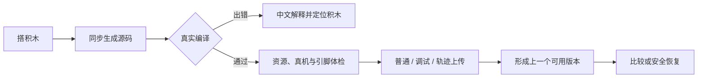

# CK

<p align="center">
  
</p>

<p align="center"><strong>让硬件开发不再靠猜。</strong></p>

CK 是一个面向 Arduino 兼容硬件的桌面开发环境。它把图形化编辑、真实编译、
真机上传、工程诊断、积木调试和版本恢复放在同一条可追溯链路中。

**CK = 可解释、可验证、可恢复的硬件开发环境。**

> **当前状态：CK 1.0 Classroom Beta**<br>
> 当前用于 Windows 本机验证与课堂封闭测试，尚不等同于公开正式发行。
> 安装包尚未完成可信代码签名与时间戳；macOS/Linux 桌面版也尚未完成正式发布验证。

## 为什么 CK 不只是图形化编程

普通图形化工具通常在“生成 Arduino 代码”后就结束了。CK 更关心接下来发生的事：
哪里错了、硬件配置是否可靠、板上实际运行了什么，以及昨天可用的版本能否恢复。

### 编译错误直接回到积木

CK 为本次生成源码保存可信源码映射。编译器报错时，错误卡片会保留原始诊断，
同时给出中文解释、可操作建议，并在证据匹配时直接定位到对应积木。第三方库、
过期源码或无法证明来源的行不会被猜成某个积木。

### 一处查看工程是否健康

“工程体检”集中展示 Flash/RAM 预算、当前真机证据、精确引脚占用、条件硬件风险和
可操作错误。同一引脚被正常重复使用不会自动等于冲突；缺少可信能力或物理位置时
显示“未知”，而不是借用相似板卡的数据。

### 积木也可以调试

CK 提供调试固件上传、积木软断点、继续、单步和可靠结束。它不是芯片硬件断点，
但能让课堂和常见 Arduino 工程直接看到程序停在哪个积木。

### 不暂停程序也能看运行路径

运行轨迹使用独立轨迹固件采样已执行的积木路径，不要求每次命中都暂停开发板。
它适合确认分支是否真的走过，但不冒充零开销的源码级覆盖率或性能分析器。

### 回到“上一个可用版本”

普通固件成功上传并通过产物与真机门禁后，CK 可以保存一个本机可用版本。用户可以：

- 与当前工程比较；
- 只恢复工程；
- 保持当前工程、只恢复固件；
- 完整恢复工程、依赖、配置和固件。

任何固件恢复仍会重新核对目标、分区、地址、文件大小和哈希，不会因为叫“恢复”就
绕过上传安全检查。

### 缺少第三方积木时先保护数据

工程中出现未知积木时，CK 会进入只读保险箱：保留原始工程，阻止编译、上传和覆盖
保存，同时允许原样导出、补装对应积木包或从检查点恢复。缺包不会被静默清洗成一个
看似正常但已经残缺的工程。

### 快速路径没有证据就不用

CK 的构建与上传采用 fail-closed 边界。Fast 路径只有在当前 Core、工具链、完整板卡
配置和本机证据匹配时才启用；否则回到 Arduino CLI Release 完整构建。上传前还会
验证目标和产物，ESP32 等已接入目标会进一步检查分区、烧录地址与实体 Flash。

## 30 秒看懂 CK



第一次体验 CK，最值得试这四件事：

1. 故意制造一个编译错误，查看错误卡片能否定位到积木。
2. 打开工程体检，查看资源预算和当前工程真实使用的引脚。
3. 选择调试上传或运行轨迹，观察积木高亮、继续与单步。
4. 完成一次普通上传，再打开“上一个可用版本”比较和恢复入口。

## 功能概览

| 范围 | 已有能力 |
| --- | --- |
| 编辑 | Blockly 编辑、同步 Arduino 代码预览、积木全局搜索与来源、深色模式、简洁/工程视图、版本化 `.ck` 工程 |
| 编译 | Arduino CLI 真实编译、Exact 缓存、持证 Fast 路径、缓存未命中解释、编译阶段与耗时、中文错误卡片与源码映射 |
| 上传 | 普通上传、调试上传、轨迹上传、串口互斥恢复、目标/产物/地址/哈希门禁、已接入目标的实体 Flash 检查 |
| 诊断 | Flash/RAM 预算、资源变化、真机体检、精确引脚风险图、工程检查项、项目验收报告、脱敏诊断包 |
| 调试 | 积木软断点、继续、单步、结束调试、非暂停运行轨迹与受限采样 |
| 恢复 | 编辑前检查点、滚动恢复稿、未知积木只读保险箱、上一个可用版本比较与三种恢复 |
| 串口 | 串口监视器、结构化数据绘图、CSV 导出与阈值触发录制 |
| 板卡与依赖 | 板卡/Core/库管理、完整板卡配置、Arduino 库依赖解析、第三方板卡包与声明式积木包 |
| 生态 | 包质量门禁、机器可读元数据、可导入示例、Extension SDK 和 `ckpkg` CLI/CI |

完整且带证据边界的状态清单见
[`docs/current-feature-inventory.md`](docs/current-feature-inventory.md)，逐项体验入口见
[`docs/CK-1.0-feature-review-checklist.md`](docs/CK-1.0-feature-review-checklist.md)。

## 当前支持与边界

- **桌面平台：**当前安装版和完整原生验收集中在 Windows。macOS/Linux 桌面正式发行
  仍未完成，不能从源码可编译推断为已支持发布。
- **板卡与 Core：**CK 内置 Arduino AVR、ESP32、ESP8266 等常用目标，但每块板、Core
  版本、菜单组合和实体硬件的证据范围不同。界面中的板卡护照、真机状态和当前功能
  清单是权威范围；相似芯片不会互相继承真板认证。
- **软断点与轨迹：**当前接入 Arduino AVR、ESP32 和 ESP8266 链路，需要重新编译并
  上传独立固件。结束会话后板上仍是调试/轨迹固件，正式部署需再次执行普通上传。
- **上一个可用固件：**完整固件恢复当前覆盖启用严格产物清单的 ESP32 与 AVR；其他
  架构不会用不完整产物冒充可恢复固件。
- **Fast：**Fast 是按当前完整身份授权的优化，不是板卡名称白名单。没有当前证据时
  仍可走 Arduino CLI Release 正常编译，只是不显示为 Fast。
- **第三方扩展：**CK 1.0 只激活通过门禁的声明式积木扩展。Legacy `blocks.js` 和
  `generator.js` 可作为迁移输入保留，但不会在主 WebView 中执行。
- **明确未完成：**AI 自动工程生成、CK Lab、`.cktrace` 离线回放、变量探针、任意表达式
  求值、公开签名认证中心和内置 PDF 渲染都不是当前已交付功能。

## 快速开始

当前公开仓库主要提供源码和开发文档。若你已从课堂封闭测试渠道获得 Windows 安装包：

1. 启动 CK，在新建工程页选择板卡；编辑器内部不会偷偷切换工程板卡。
2. 拖入积木并查看同步生成的 Arduino 源码。
3. 点击“编译”；错误会进入可操作错误卡片，成功结果会更新资源体检。
4. 需要连接真机时选择串口，再使用“普通上传”。调试和运行轨迹是明确分开的固件模式。
5. 普通上传成功并满足证据条件后，从“上一个可用版本”查看比较与恢复操作。

> Classroom Beta 安装包尚未完成可信代码签名和时间戳，不应作为已满足公开正式分发
> 要求的软件对外宣传。

## 从源码运行

环境要求：Node.js 20、Rust stable、Windows WebView2，以及 Tauri 2 所需的原生构建工具。

```powershell
cd apps/desktop
npm ci
npm run desktop:dev
```

生成本机安装包：

```powershell
cd apps/desktop
npm ci
npm run desktop:build
```

公开仓库不提交用户工程、下载后的板卡 Core、构建缓存、诊断包或本机性能资格证据。
因此自行构建的程序在缺少当前有效证据时会安全回退 Arduino CLI Release，而不会把
未经验证的路径显示成 Fast。

## Extension SDK / 第三方开发

CK 将三类导入边界明确分开：

| 类型 | 核心入口 | 用途 |
| --- | --- | --- |
| 第三方板卡包 | `board.json` | 描述精确板卡、Core 策略、配置、引脚和有限验证信息 |
| 声明式积木库 | `library.json` + `ck-blocks.json` | 描述积木语义、参数、依赖、硬件约束和声明式代码生成 |
| Arduino 源码库 | `library.properties` + `src/**` | 作为编译依赖导入，不伪装成积木包 |

标准、Schema 和完整示例没有删除，只从产品首页下移到开发者入口：

- [第三方积木库标准](docs/blockly-library-package-standard.md)
- [第三方板卡护照与 Core 策略](docs/third-party-board-passport.md)
- [包质量门禁](docs/package-quality-gates.md)
- [可直接导入的板卡、积木和深层 Arduino 库示例](examples/importable-packages/README.md)
- [Extension SDK 总览](docs/extension-sdk/README.md)
- [`ckpkg` CLI 使用说明](docs/extension-sdk/ckpkg.md)
- [从零创建传感器积木库](docs/extension-sdk/sensor-library-tutorial.md)

`ckpkg` 提供创建、检查、测试、真实 compile-only 和打包流程：

```powershell
ckpkg create my-sensor
ckpkg validate .\my-sensor
ckpkg test .\my-sensor
ckpkg compile .\my-sensor esp32-c6
ckpkg pack .\my-sensor --out .\my-sensor-0.1.0.zip
```

每条命令提供稳定退出码与机器可读输出。`compile` 调用真实 Arduino CLI，只编译不上传；
失败不会伪装为通过。SDK 的构建、安装与 CI 模板见 `docs/extension-sdk/`。

## Specification / 开发文档

[`CK Specification Index`](docs/specification/README.md) 是格式与安全边界的统一入口，
用于区分稳定规范、内部实现和延期方向。常用文档：

- [CK Project Format v1](docs/ck-project-format-v1.md)
- [上一个可用版本与工程诊断包](docs/last-working-version-and-diagnostics.md)
- [编译与包回归边界](docs/compiler-and-package-regression-baseline.md)
- [积木调试与可靠性范围](docs/p0-plus-reliability-roadmap.md)
- [明确延期、不得宣传为已完成的能力](docs/deferred-platform-roadmap.md)
- [CK 1.0 发布与封闭测试边界](docs/v1-release-readiness.md)

## 作者与署名

CK 支持学习、修改、二次开发和继续开源。项目作者与维护者：
**jackchen（GitHub：[@ovoVHV](https://github.com/ovoVHV)）**。

如果你的项目复用了 CK 仓库中的源码、设计文档、Schema、构建脚本或具体实现，请：

1. 保留适用的 `LICENSE`、`NOTICE` 和文件内版权声明；
2. 在项目 README、NOTICE 或“关于”页面明确注明 CK、原仓库和作者；
3. 不把第三方修改版表述为 CK 官方认证或官方发行版本。

可使用下面的署名：

> 基于 CK 项目的技术与实现，原作者 jackchen（[@ovoVHV](https://github.com/ovoVHV)）。<br>
> 来源：[github.com/ovoVHV/CK](https://github.com/ovoVHV/CK)

感谢每一位尊重开源许可证、注明技术出处并继续分享改进的开发者。

## License

CK 源码以 [Apache License 2.0](LICENSE) 发布。第三方 Core、工具和库继续遵循各自许可证；
随桌面端分发的第三方组件说明见
[`apps/desktop/src-tauri/THIRD_PARTY_NOTICES.md`](apps/desktop/src-tauri/THIRD_PARTY_NOTICES.md)。
